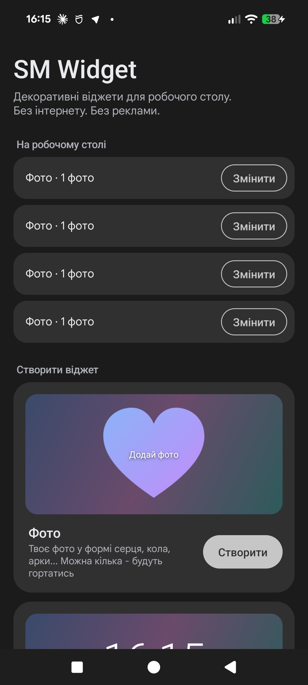
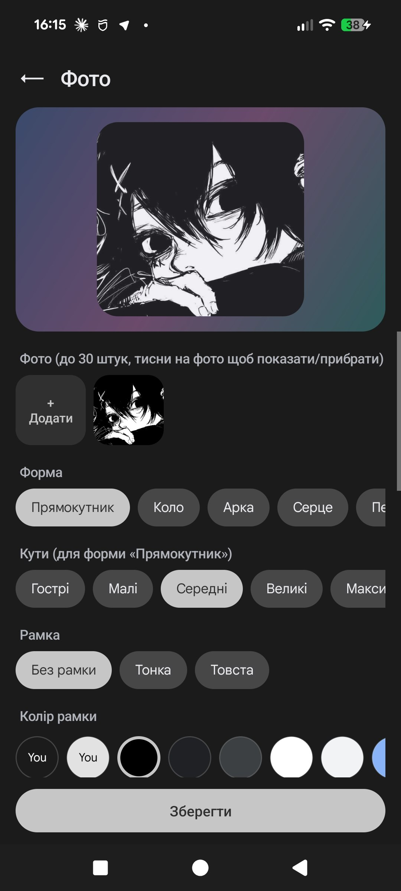
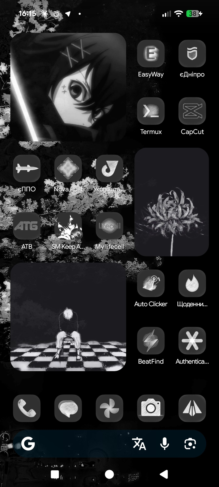

# SM Widget

[Українська](README.uk.md)

Decorative home-screen widgets for Android. Built for my Pixel. Works fully offline: the app has no internet permission, no ads and no third-party libraries.

<p>
  
  
  
</p>

## Widgets

- **Photo** - your photo in a shape (rectangle, circle, arch, heart and more), up to 30 photos that rotate, frames, corner radius, filters, transparency
- **Clock** - time and date with a choice of fonts and alignment
- **Text** - any text: a quote, a name, a reminder
- **Battery** - battery charge ring
- **Progress** - progress of the day, week, month or year
- **Countdown** - days left until an event

Each widget is set up in the app and pinned to the home screen from there.

## Tech

- Java, Android SDK only (no AndroidX, no dependencies)
- minSdk 29, targetSdk 35, version 1.2
- Widgets are built with `RemoteViews`; photo images are rendered in the app and served to the launcher through a `ContentProvider`
- `gen/layouts.py` generates widget layouts for every font and alignment combination

## Project structure

```
app/src/main/java/com/sm/widget/
  Cfg              widget settings (JSON in SharedPreferences)
  Render           builds RemoteViews for all widget types
  Photos           photo import, shapes, frames, filters, transparency
  PhotoProvider    gives the launcher ready widget images
  *Widget          widget providers
  MainActivity, ConfigActivity, Ui   app screens
gen/layouts.py     layout generator
```

## Build

1. Android SDK (platform 35, build-tools 35) and Gradle 8.13+.
2. Create `local.properties` with `sdk.dir=/path/to/android-sdk`.
3. To sign a release build, copy `keystore.properties.example` to `keystore.properties` and fill it in. Without it the release build is unsigned.
4. `gradle assembleRelease` - the APK is in `app/build/outputs/apk/release/`.

## Author

S-Mykhailo - [@savchenko_mykhailo](https://t.me/savchenko_mykhailo)

## License

GPL-3.0-or-later. You can use, change and share this code, but any modified version you distribute must also be open source under the GPL. See [LICENSE](LICENSE).
