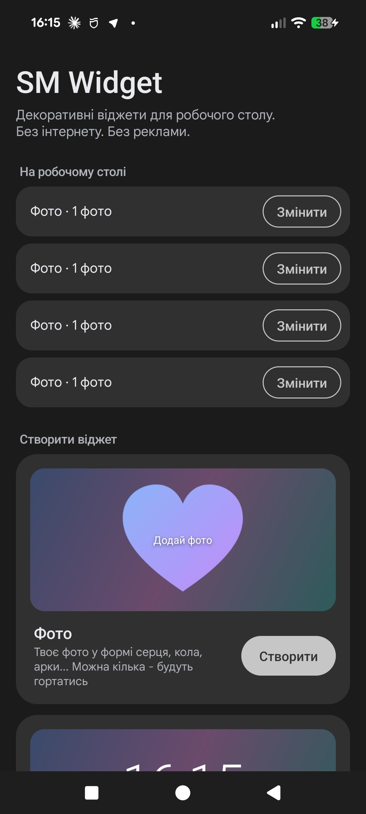
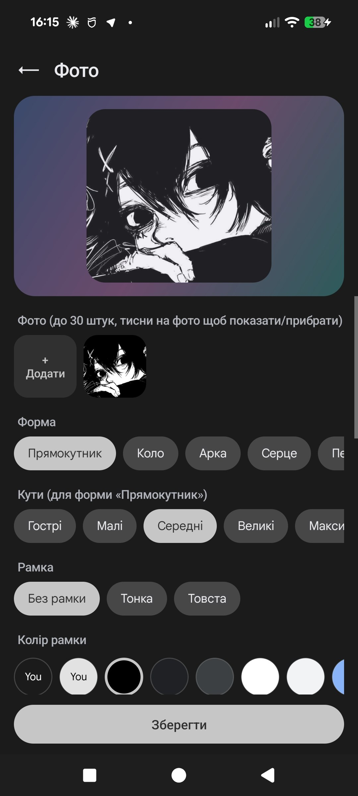
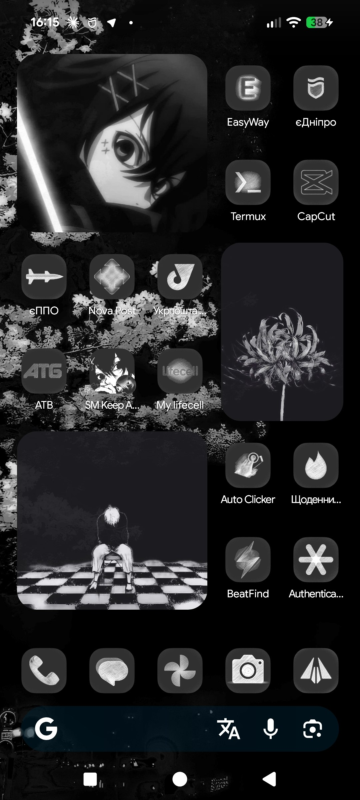

# SM Widget

[English](README.md)

Декоративні віджети для робочого столу Android. Робив під свій Pixel. Працює повністю офлайн: у застосунку немає дозволу на інтернет, реклами і сторонніх бібліотек.

<p>
  
  
  
</p>

## Віджети

- **Фото** - твоє фото у формі (прямокутник, коло, арка, серце та інші), до 30 фото, які гортаються, рамки, заокруглення кутів, фільтри, прозорість
- **Годинник** - час і дата, різні шрифти і вирівнювання
- **Текст** - будь-який текст: цитата, ім'я, нагадування
- **Батарея** - кільце заряду
- **Прогрес** - прогрес дня, тижня, місяця чи року
- **Відлік** - скільки днів лишилось до події

Кожен віджет налаштовується в застосунку і звідти ж додається на робочий стіл.

## Технічне

- Java, тільки Android SDK (без AndroidX і залежностей)
- minSdk 29, targetSdk 35, версія 1.2
- Віджети зроблені на `RemoteViews`; картинки фото-віджетів рендеряться в застосунку і віддаються лаунчеру через `ContentProvider`
- `gen/layouts.py` генерує макети віджетів для всіх комбінацій шрифту і вирівнювання

## Структура

```
app/src/main/java/com/sm/widget/
  Cfg              налаштування віджета (JSON у SharedPreferences)
  Render           збирає RemoteViews для всіх типів
  Photos           імпорт фото, форми, рамки, фільтри, прозорість
  PhotoProvider    віддає лаунчеру готові картинки віджетів
  *Widget          провайдери віджетів
  MainActivity, ConfigActivity, Ui   екрани застосунку
gen/layouts.py     генератор макетів
```

## Збірка

1. Android SDK (platform 35, build-tools 35) і Gradle 8.13+.
2. Створи `local.properties` з рядком `sdk.dir=/шлях/до/android-sdk`.
3. Щоб підписати release-збірку, скопіюй `keystore.properties.example` у `keystore.properties` і заповни. Без нього release-збірка буде непідписаною.
4. `gradle assembleRelease` - APK буде в `app/build/outputs/apk/release/`.

## Автор

S-Mykhailo - [@savchenko_mykhailo](https://t.me/savchenko_mykhailo)

## Ліцензія

GPL-3.0-or-later. Код можна використовувати, змінювати і поширювати, але будь-яка змінена версія, яку ти поширюєш, теж має бути відкритою під GPL. Див. [LICENSE](LICENSE).
